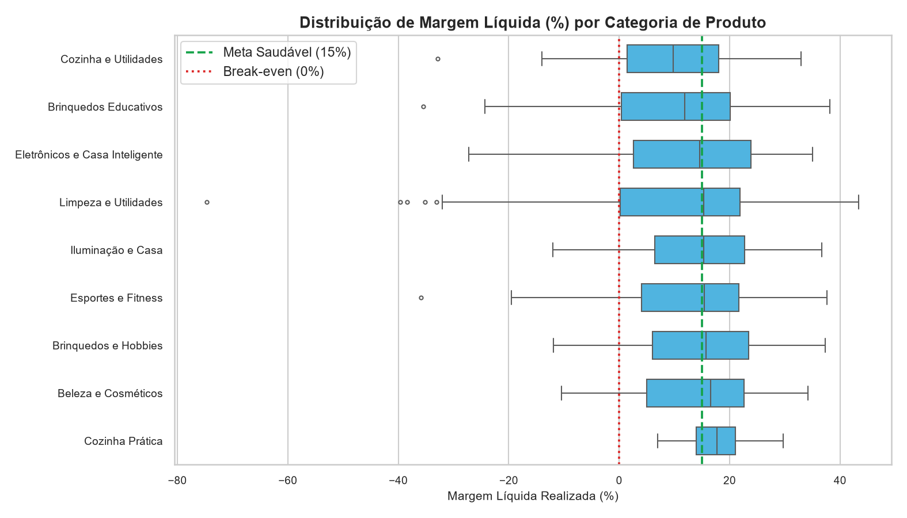
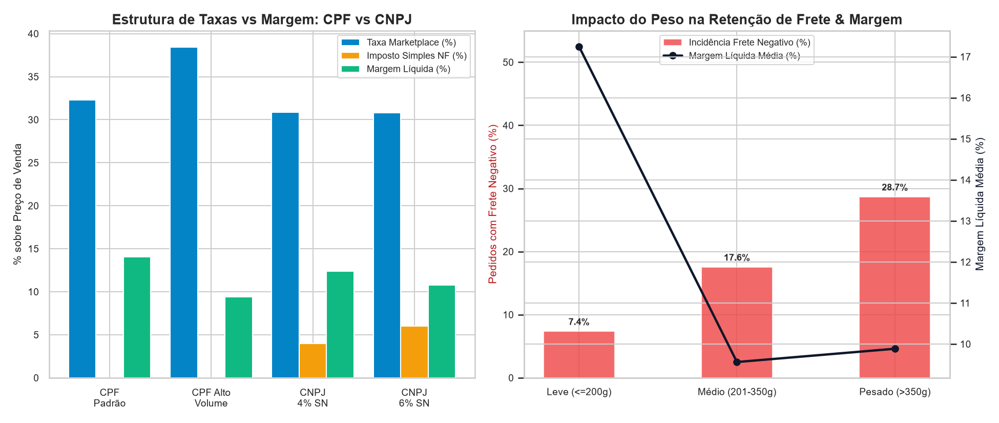
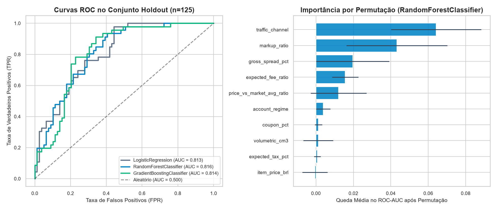
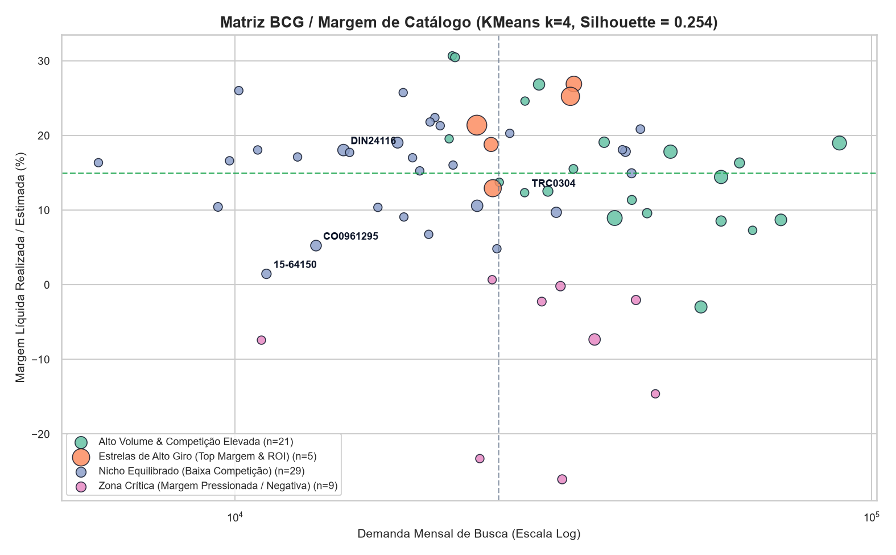

# E-commerce Margin Arbitrage & Financial Reconciliation ML

Sistema híbrido de **Auditoria Financeira Determinística (`Decimal`)**, **Analytics SQL** e **Machine Learning** para proteção de margem líquida, detecção de divergências de repasse e segmentação de portfólio no varejo digital brasileiro (`Supplier_B2B` → `Marketplace_BR`).

---

## 1. Contexto de Negócio e Problema

Operações de e-commerce e *dropshipping* B2B nacional enfrentam erosão silenciosa de lucratividade mesmo quando o faturamento (GMV) cresce. Os quatro principais gargalos auditados neste projeto são:

1. **Assimetria de Regime Fiscal e Comissionamento:** Contas **CPF Padrão**, **CPF Alto Volume** (sobretaxa fixa de R$ 3,00/unidade acima de 450 pedidos/90 dias) e **CNPJ Simples Nacional** (4% ou 6% de alíquota sobre venda bruta) alteram drasticamente o *break-even* de cada SKU.
2. **Saltos de Faixa de Preço:** Mudanças na tabela de comissão por preço unitário (ex.: 20% + R$ 4,50 até R$ 79,99 → 14% + R$ 16,00 entre R$ 80,00 e R$ 99,99) geram anomalias de margem na fronteira de precificação.
3. **Retenção de Frete por Peso/Cubagem:** Divergências logísticas geram cobranças líquidas negativas no repasse (`net_shipping_brl < 0`).
4. **Risco de CPA e Divergências de Repasse:** Campanhas pagas cujo CPA efetivo supera a margem de contribuição unitária ou cobranças de taxa acima do teto contratual (`fee_delta_brl >= R$ 0,02`).

---

## 2. Arquitetura da Solução

```text
  Catálogo Sanitizado + Pedidos Piloto (OBSERVED_SANITIZED)
                             │
                             ▼
  ┌──────────────────────────────────────────────────────────┐
  │  src/audit_engine.py (Aritmética Exata Decimal + NLP)    │
  │  • Regras contratuais por faixa de preço e regime fiscal │
  │  • Classificação estrita: OK | ERRO_COMPROVADO | SUSPEITA│
  │  • Matcher NLP por tokens em português (Jaccard)         │
  │  • Trilha criptográfica SHA-256 por transação            │
  └──────────────────────────┬───────────────────────────────┘
                             │
                             ▼
  ┌──────────────────────────────────────────────────────────┐
  │  src/prepare_dataset.py (Expansão Reprodutível, seed=42) │
  │  • data/sku_catalog.csv (64 SKUs)                        │
  │  • data/orders_reconciliation.csv (500 pedidos)          │
  │  • Separação explícita via coluna `data_origin`          │
  └──────────┬──────────────────────────────┬────────────────┘
             │                              │
             ▼                              ▼
  ┌─────────────────────────┐    ┌───────────────────────────┐
  │ sql/ + SQLite Validator │    │ src/train_margin_models.py│
  │ • dim_sku_catalog       │    │ • Classificação Leak-Free │
  │ • fact_orders_reconcil. │    │ • Clusterização BCG KMeans│
  │ • mart_margin_risk      │    │ • Modelos + 4 Gráficos    │
  └─────────────────────────┘    └───────────────────────────┘
```

### Governança de Dados e Privacidade (`data_origin`)
Todos os identificadores reais de lojistas, fornecedores e plataformas foram sanitizados para aliases genéricos (`Merchant_Demo`, `Seller_001`..`Seller_006`, `Supplier_B2B`, `Marketplace_BR`), sem exposição de credenciais, cookies, URLs ou dados pessoais. A coluna `data_origin` distingue rigorosamente:
- **`OBSERVED_SANITIZED`**: **24 SKUs** reais sanitizados do catálogo B2B e **16 pedidos** reais auditados (`OBS-M01` a `OBS-M16`, totalizando **R$ 129,83** de contribuição parcial verificável nos 15 pedidos calculáveis).
- **`SYNTHETIC_AUGMENTED`**: **40 SKUs** e **484 pedidos** gerados deterministicamente (`seed=42`) aplicando as regras reais de comissão por faixa, tributo Simples Nacional, risco de cubagem por peso e elasticidade de preço, totalizando **64 SKUs** e **500 pedidos**.

---

## 3. Resultados Observados (EDA, SQL & Machine Learning)

### 3.1 Descobertas de Negócio e Testes Estatísticos
- **Distribuição de Auditoria (500 pedidos):** `299 OK` (59,8%), `187 ERRO_COMPROVADO` (37,4%) e `14 SUSPEITA` (2,8%, reembolsos/indeterminados). Apenas **36,60%** dos pedidos atingiram margem líquida saudável (`>= 15%` e sem divergência financeira).
- **Impacto Estatístico do Peso na Retenção de Frete (H1):** Pedidos com frete líquido negativo apresentam peso mediano significativamente maior que pedidos sem retenção (`0,329 kg` vs `0,262 kg`, Mann-Whitney `U = 22840,0`, `p = 7,5960e-08`).
- **Markup vs. Margem Líquida (H2):** Correlação forte de Spearman entre `markup_ratio` e `net_margin_pct` (`rho = 0,7412`, `p = 7,8749e-86`).
- **Comparação Estrutural CPF vs. CNPJ (`q3_cpf_vs_cnpj_regime`):**

| Regime Fiscal | Pedidos | Ticket Médio | Taxa Efetiva Marketplace | Imposto NF | Margem Líquida Média | Taxa Saudável |
|---|---:|---:|---:|---:|---:|---:|
| `CPF_PADRAO` | 161 | R$ 64,31 | 32,34% | 0,00% | **14,04%** | 40,99% |
| `CNPJ_SIMPLES_4PCT` | 130 | R$ 80,24 | 31,19% | 4,00% | **12,39%** | 37,69% |
| `CNPJ_SIMPLES_6PCT` | 90 | R$ 82,39 | 31,10% | 6,00% | **10,76%** | 38,89% |
| `CPF_ALTO_VOLUME` | 105 | R$ 76,76 | 39,48% | 0,00% | **9,43%** | 31,43% |





---

### 3.2 Parte A — Classificação Supervisionada *Leak-Free* (`is_healthy_margin`)

Previsão preventiva se um pedido atingirá **margem líquida >= 15% e zero divergência financeira** utilizando **apenas 17 atributos ex-ante** (preço, custo fornecedor, markup, spread bruto, peso, cubagem, demanda mensal, CPA alvo, regime fiscal, canal de tráfego e concorrência — sem qualquer coluna pós-liquidação). Split estratificado: `375` treino (`StratifiedKFold`, 5 folds) / `125` holdout.

| Modelo | CV Accuracy | CV F1-Score | CV ROC-AUC | Holdout Accuracy | Holdout F1-Score | Holdout ROC-AUC |
|---|---:|---:|---:|---:|---:|---:|
| **`RandomForestClassifier`** *(Campeão AUC)* | **0.7547** | 0.6450 | 0.8304 | 0.7200 | 0.5882 | **0.8156** |
| `GradientBoostingClassifier` | 0.7520 | **0.6603** | **0.8409** | **0.7680** | **0.7010** | 0.8140 |
| `LogisticRegression` | 0.7493 | 0.6369 | 0.8312 | 0.7200 | 0.6067 | 0.8126 |

**Top 5 Variáveis por Importância de Permutação (Holdout ROC-AUC):**
1. `traffic_channel` (`0.0642 ± 0.0241`)
2. `markup_ratio` (`0.0432 ± 0.0270`)
3. `gross_spread_pct` (`0.0196 ± 0.0195`)
4. `expected_fee_ratio` (`0.0156 ± 0.0070`)
5. `price_vs_market_avg_ratio` (`0.0121 ± 0.0149`)



---

### 3.3 Parte B — Clusterização Não Supervisionada de Catálogo (`KMeans k=4`)

Segmentação dos 64 SKUs por margem efetiva, demanda mensal (`log`), proxy de giro (`estimated_niche_sales_month / stock_units`) e score de competição (`StandardScaler + KMeans`):
- **Silhouette Score (`k=4`):** `0.2538` (grid avaliado: `k=3: 0.2305`, `k=4: 0.2528`, `k=5: 0.2633`).

| Cluster BCG / Margem | SKUs | Margem Média | Busca Mensal Média | Proxy de Giro | ROI sobre CPA |
|---|---:|---:|---:|---:|---:|
| **Estrelas de Alto Giro (Top Margem & ROI)** | 5 | **21,06%** | 28.460 | 83,22 | **3,34x** |
| **Nicho Equilibrado (Baixa Competição)** | 29 | **15,49%** | 20.794 | 18,78 | 2,68x |
| **Alto Volume & Competição Elevada** | 21 | **15,45%** | 43.521 | 30,40 | 2,32x |
| **Zona Crítica (Margem Pressionada / Negativa)** | 9 | **-9,17%** | 31.228 | 19,87 | 0,53x |



---

## 4. Camada SQL Analítica (PostgreSQL + Validação SQLite)

O schema relacional em [`sql/schema_postgresql.sql`](sql/schema_postgresql.sql) define `dim_sku_catalog` (`64` linhas), `fact_orders_reconciliation` (`500` linhas) e `mart_margin_risk` (`207` pares SKU × regime). Todas as **7 queries** em [`sql/analytical_queries.sql`](sql/analytical_queries.sql) foram validadas com **0 erros** via [`src/run_sql_validation.py`](src/run_sql_validation.py).

Exemplo — Impacto das faixas de peso na erosão por frete (`q2_freight_weight_impact`):
```sql
SELECT
    CASE
        WHEN weight_kg <= 0.200 THEN '1_LEVE_ATE_200G'
        WHEN weight_kg <= 0.350 THEN '2_MEDIO_201G_A_350G'
        ELSE '3_PESADO_ACIMA_350G'
    END AS weight_bracket,
    COUNT(*) AS total_orders,
    ROUND(100.0 * SUM(CASE WHEN net_shipping_brl < 0 THEN 1 ELSE 0 END) / COUNT(*), 2) AS freight_loss_incidence_pct,
    ROUND(AVG(net_margin_pct), 2) AS avg_net_margin_pct
FROM fact_orders_reconciliation
WHERE audit_classification <> 'SUSPEITA'
GROUP BY weight_bracket
ORDER BY weight_bracket;
```

---

## 5. Estrutura do Repositório

```text
ecommerce-margin-arbitrage-ml/
├── data/
│   ├── raw_sanitized/                # Sementes sanitizadas sem PII/identificadores reais
│   ├── sku_catalog.csv               # 64 SKUs (24 observados + 40 sintéticos)
│   └── orders_reconciliation.csv     # 500 pedidos auditados (16 observados + 484 sintéticos)
├── models/
│   ├── margin_risk_classifier.joblib # Pipeline sklearn vencedor (RandomForestClassifier)
│   └── sku_kmeans_clusterer.joblib   # Pipeline StandardScaler + KMeans (k=4)
├── notebooks/
│   └── 01_ecommerce_margin_eda_and_ml.ipynb  # Notebook executado com gráficos e saídas salvas
├── reports/
│   ├── figures/                      # 4 visualizações analíticas em PNG
│   ├── ml_metrics.json               # Métricas exatas de CV, Holdout e KMeans
│   ├── sku_clusters.csv              # Catálogo enriquecido com rótulos de cluster
│   └── sql_validation_summary.json   # Saída estruturada das 7 queries SQL
├── sql/
│   ├── schema_postgresql.sql         # DDL PostgreSQL (dim, fact e mart)
│   └── analytical_queries.sql        # 7 queries analíticas ANSI SQL + Window Functions
├── src/
│   ├── audit_engine.py               # Motor determinístico Decimal + Matcher NLP PT-BR
│   ├── prepare_dataset.py            # Sanitização e geração reprodutível dos CSVs
│   ├── run_sql_validation.py         # Validador SQLite em memória do schema e queries
│   └── train_margin_models.py        # Treino supervisionado, clusterização e gráficos
├── tests/
│   └── test_audit_and_ml.py          # Suite pytest (Decimal, NLP, privacidade, SQL e ML)
├── .gitignore
├── requirements.txt
└── README.md
```

---

## 6. Como Reproduzir Localmente

```bash
# 1. Criar ambiente virtual e instalar dependências com uv
uv venv .venv
uv pip install --python .venv/Scripts/python.exe -r requirements.txt

# 2. Gerar datasets sanitizados e expandidos
.venv/Scripts/python.exe src/prepare_dataset.py

# 3. Validar DDL e queries SQL (gera reports/sql_validation_summary.json)
.venv/Scripts/python.exe src/run_sql_validation.py

# 4. Treinar modelos de ML, clusterização e gerar os 4 gráficos
.venv/Scripts/python.exe src/train_margin_models.py

# 5. Executar notebook completo
.venv/Scripts/jupyter.exe nbconvert --to notebook --execute --inplace notebooks/01_ecommerce_margin_eda_and_ml.ipynb

# 6. Rodar testes automatizados (inclui auditoria de privacidade e anti-leakage)
.venv/Scripts/pytest.exe -v
```
